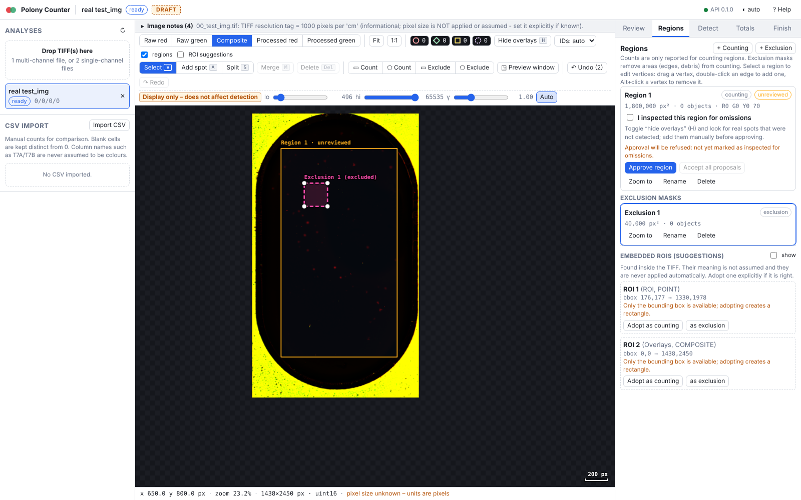
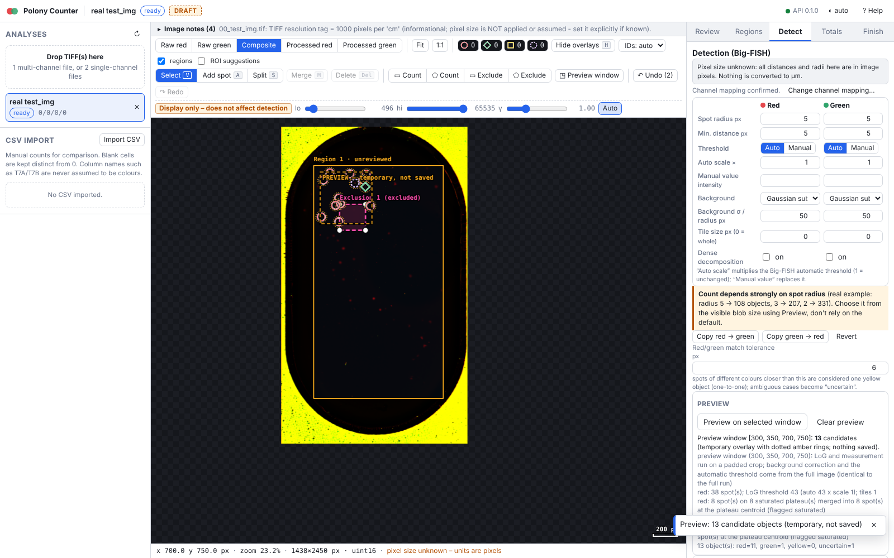
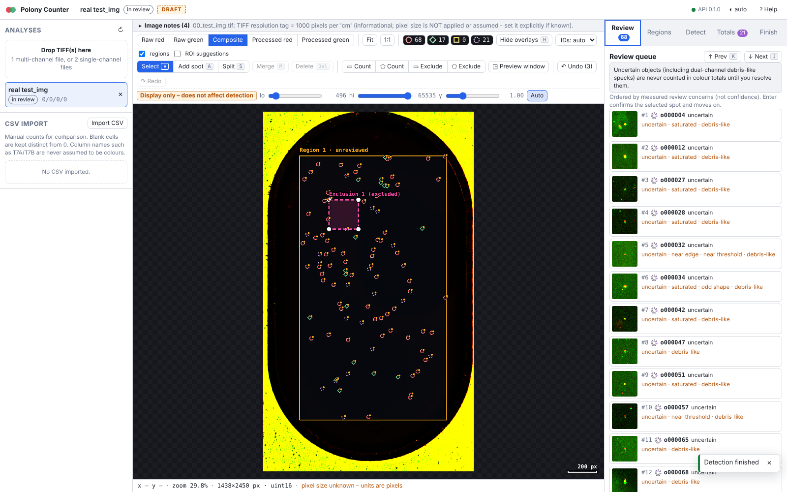

# Polony Review App: user guide

The app proposes polony positions with a classical spot detector (Big-FISH LoG), and **you decide**. Nothing is counted as final until every counting region has
been inspected and approved by a person and the analysis has been finalized. It is a human-in-the-loop tool, not an autonomous counter.

> **Validation status.** The detector has been checked on one real red-only image (`resources/dataset_files/test/test_img.tif`, 2450 x 1438, 2 pages uint16, scored against one annotator's marks) and on synthetic images
> for software behaviour. The research TIFFs named in the task (`29-09-2026_T7_AB_*.tif` etc., described as 1460 x 2438) were **not available** in the workspace, so
> no accuracy on them is claimed. Green and yellow polony performance is untested on real data. See [SCIENTIFIC_OPEN_QUESTIONS.md](SCIENTIFIC_OPEN_QUESTIONS.md).

Start: `make app`, then open http://127.0.0.1:8000 (see [README.md](README.md)).
Installed version: the Desktop icon opens Polony Review in its own window; closing it stops the app unless a detection is running, in which case it asks (see "Window mode" in [INSTALL.md](INSTALL.md)).

Screenshots in `img/` come from an earlier acceptance run on test_img.tif; the numbers visible in them predate later fixes (e.g. debris handling), so use them only to find your way around the UI.

## Layout

* **Left rail**: list of analyses (status chip, counts), TIFF upload (drag and drop), CSV import.
* **Centre**: viewer (wheel zoom about the cursor, drag to pan, Fit / 1:1, five views, contrast sliders that affect display only, coordinate readout, scale bar) and toolbar.
* **Right panel**: inspector for the selection and tabs **Review**, **Regions**, **Detect**, **Totals**, **Finish**.
* `?` opens the shortcut list.

## 1. Upload

Drop one multi-page TIFF (two channels), two single-channel TIFFs, or an RGB composite. Originals are copied (never modified) and hashed (sha256). Embedded ImageJ ROIs/overlays are parsed and
shown only as **suggestions**; the TIFF resolution tag is shown as information only. **Pixel size is never assumed.** An RGB composite-only upload has no raw channels, so per-channel detection is only an approximation
and the UI says so.

## 2. Channel mapping (mandatory)

A dialog asks which physical channel is **red**, which is **green**, or **ignore**. Metadata text such as `635 [W1]` is only a hint, and file names are not proof. Detection, approval and
finalizing are blocked until you confirm. Changing the mapping later makes the detection stale and clears all approvals and inspection marks; a confirmed red<->green swap mirrors object classes
and evidence (see [RERUN_POLICY.md](RERUN_POLICY.md)). A residual channel offset can be estimated/applied as an integer green->red shift through the API (`POST /api/analyses/{id}/alignment`; there is no UI control yet); the estimate is only a suggestion and was unreliable on test_img because the channels share little structure.

## 3. Regions and exclusions

Draw at least one **counting region** (rectangle or polygon tool; vertices can be dragged, double-click an edge adds one, Alt+click removes one). Draw **exclusion masks** over rim glare, the
saturated area outside the chamber, debris or artefacts. Only objects inside a counting region and outside every exclusion are counted. Approval is per counting region. A single geometry rule (pixel centres, half-open edges) is used for detection,
membership and area; areas are pixel-centre counts. The automatic threshold is computed only from the masked area, so a sensible region improves detection itself, not only the counts.

### Grid: click to select, Randomise

Regions tab, **Generate grid…**: rows, columns, cell size, origin, numbering order and start corner. **Preview on image**
shows the grid before anything is stored (dashed cyan).

* **Apply** stores the grid with the analysis (it survives a reload) and creates one counting region `Field-N` per cell.
  The tool switches to **Pick fields**: click a field on the image to count it, click it again to skip it (skipped = blank
  in the CSVs, counted with no polonies = 0). Counted fields have a solid outline and their number, skipped ones a dotted
  grey outline; the field under the cursor is highlighted. Keys while picking: **A** all, **N** none, **I** invert, **Esc**
  leaves the tool. A field fully inside an exclusion mask cannot be switched on.
* **Randomise** keeps the rows, columns and cell size and moves the whole grid to a random position that stays inside the
  image (whole pixels). The seed is recorded with the grid (shown under *Grid fields* and in `provenance.json`), so the
  position can be reproduced. Ctrl+Z undoes it.
* Applying again (or randomising) keeps each field's on/off choice by field number. A field that does not move keeps its
  approval; a field that moves loses it, exactly as when a region is edited by hand. **Apply** always puts the grid at
  the origin in the form (no random shift).
* **Remove grid** deletes the grid and its field regions; it is refused while a grid field is approved.

The rectangle and polygon tools stay available for exclusions and for slides without a grid.

## 4. Parameters and preview

The **Detect** tab holds the parameters of [PARAMETERS.md](PARAMETERS.md) for red and green and the match tolerance. Use **Preview on selected window** (drag a window): temporary dotted amber rings show what would be found there with the
current parameters; nothing is saved. Tune the spot radius to the visible blob size first, and keep it matched to the real spots: the debris-like flag is relative to the configured radius (a blob with sigma below about 0.6 x radius counts as compact), so a radius that is too large turns genuine small polonies into `debris_like` / `uncertain` (in a synthetic test all 144 small dual-channel polonies with sigma 1.5-3 px were `uncertain` at radius 5). The threshold is in noise units (LoG response divided by its robust noise sigma), so it does not change with image brightness; a value below about 5 is noise. If a channel is empty or nearly empty the run shows a WARNING (noise-regime threshold or mostly debris-like spots): confirm it visually before trusting its count.

## 5. Detection

**Run detection** starts a background job (progress, cancel). The result is a set of objects of four classes:

| Class | Meaning |
|---|---|
| `red` | red-only: a spot in the red channel with no partner in the green channel within the match tolerance |
| `green` | green-only: the same for green |
| `yellow` | dual-positive: a red and a green spot paired one-to-one within the tolerance (position = mean of the two) |
| `uncertain` | unresolved: ambiguous red/green association, or debris-like in both channels of a pair. **Never included in any colour total**, reported separately, and blocks approval until you reclassify or delete it |

"Re-run detection" keeps your edits and reviewed objects, replaces only untouched automatic ones, never resurrects objects you deleted, and clears approvals of regions whose objects changed (details in [RERUN_POLICY.md](RERUN_POLICY.md)).

## 6. Review queue

The **Review** tab lists objects with a measured concern, most urgent first (`uncertain`/`ambiguous_match`, `saturated`, `weak_signal`/`near_threshold`, `debris_like`, `dense_cluster`, `suspicious_shape`, `near_edge`), then by position.
**J / K** go to the next/previous item, **Enter** marks the selected object reviewed and advances. Objects without any reason are not queued, but they are still your responsibility: use the region inspection step below.

What the reasons mean (cut-offs in [PARAMETERS.md](PARAMETERS.md); they are unvalidated starting points):

* **debris-like**: the spot is more compact/sharp than a typical polony (small-scale LoG response >= large-scale response). Autofluorescent dust is typically small, very bright and visible in both channels. It is a **flag, not a verdict**: some real, small young polonies may look like this. A pair that is debris-like in both channels is shown as `uncertain` rather than yellow.
* **uncertain**: the app declines to choose a class. You must look at both channels and decide.
* weak signal, near threshold, saturated, dense cluster, suspicious (elongated or oversized) shape, near edge, ambiguous match are as named.

## 7. Edits

| Action | How |
|---|---|
| Move | drag a spot with the select tool |
| Add | tool Add (A), click empty space; class from the toolbar or R/G/Y/U. Only possible inside a counting region |
| Delete | select, Del (soft delete; kept in history; suppresses re-detection at that spot) |
| Reclassify | select, R / G / Y / U |
| Merge | select two or more, M: one object at the centroid, evidence united |
| Split | select one, S, click the two new positions |
| Confirm | Enter (marks reviewed) |
| Undo / redo | Ctrl+Z / Ctrl+Shift+Z (server-side, survives restarts) |

Edited automatic objects get `origin = edited`; added ones `origin = manual`.

## Save: labelled scan and CSV next to the original

1. **Open from disk** (left rail) opens a TIFF in place, so the app knows its folder. (A dragged-in upload has no folder: the Save tab then asks for an output folder.) Confirm the channel mapping as usual.
2. Create the grid (Regions tab, same size as in ImageJ), run detection and review the labels.
3. **Save tab**
   * *What to count*: tick red only / green only / yellow (red + green). The text written in the CSV is generated (`red, not yellow`, `yellow`, `red and yellow`, ...) and can be edited. **+ Count something else too** adds another row; every row becomes its own row in the experiment CSV.
   * *Grid fields to count*: click a field to switch it off (bad area) or back on. Off = blank in the CSV; counted with no polonies = 0. Numbers above 24 are not allowed (the lab template ends at Field24).
   * **Save** writes, next to the original scan (`<name>` = file name without extension; the original is never modified):
     * `<name>_labeled.tif`: RGB scan with the grid, per-field counts and a ring around every counted object (orange red-only, cyan green-only, yellow yellow).
     * `<name>.csv`: `SlideID, Total number of polonies, Field1 ... Field24`. With several rows: `<name>__<what-counted>.csv`, one per row.
     * `experiment_counts.csv` (one per folder): `Slide name, What counted, NofPol, NofGrids, Field1 ... Field24`. Saving the same slide + "what counted" again replaces its row; other slides are kept. An existing file with a different header is never overwritten.
   * Save does not require finalizing; uncertain objects are never counted, and the report lists unapproved fields.

API: `GET /api/fs/list`, `POST /api/analyses/open-path`, `PUT /api/analyses/{id}/grid`, `PUT /api/analyses/{id}/grid-selection`, `POST /api/analyses/{id}/save-slide`.

## 8. Keyboard shortcuts

| Key | Action |
|---|---|
| Wheel | zoom about the cursor |
| Drag on empty space / Space+drag / middle-drag | pan |
| F | fit image |
| 1 / 2 / 3 / 4 / 5 | raw red / raw green / composite / processed red / processed green |
| H | hide or show all overlays |
| V | select tool (click; Shift+click multi-select; Shift+drag box select) |
| A | add mode (toggle); R/G/Y/U switch the class of new spots |
| R / G / Y / U | set class of selected spot(s): red-only / green-only / yellow / uncertain |
| Del | delete selected |
| M | merge selected (two or more) |
| S | split the selected spot, then click two positions |
| Enter | confirm selected and advance in the queue |
| J / K | next / previous queue item |
| Ctrl+Z / Ctrl+Shift+Z (Ctrl+Y) | undo / redo |
| A / N / I (Pick fields tool) | count all grid fields / none / invert |
| Polygon tool | click vertices; double-click, Enter or click the first point to finish; Backspace removes the last vertex; Esc cancels |
| Esc | cancel tool / clear selection |
| ? | help |

Editing keys are disabled when the analysis is finalized.

## 9. Region inspection (checking for omissions)

The detector can miss real spots, and a review queue cannot show what was not detected. For each counting region:

1. Press **H** to hide all overlays and look at the raw/processed channels for real spots without a marker; switch views (1-5) and zoom. Add what you find with the Add tool.
2. Tick **"I inspected this region for omissions"**.
3. Optionally **Accept all proposals**: marks all non-deleted, non-uncertain objects of the region reviewed (refused until the region is marked inspected). This is a bulk confirmation of what you have seen; use it deliberately.
4. Resolve every `uncertain` object (reclassify or delete).

## 10. Approval

**Approve region** requires: region inspected, zero unresolved `uncertain`, detection not stale and detection having run (or objects existing). Approval is bound to a fingerprint of the region polygon, overlapping exclusions, the ids/positions/classes of its objects,
the channel roles and the alignment. **Any later change inside the region (add, move, delete, reclassify, merge, split, re-detection, region/exclusion edit, mapping or alignment change) clears that region's approval.** Un-approve is always possible. Undo that
restores an identical state restores a valid approval.

## 11. Finalize and reopen

The **Finish** tab shows a checklist; **Finalize analysis** is enabled only when: at least one counting region exists, every counting region is approved, the channel mapping is confirmed, and the detection is not stale. After finalizing, all mutating actions return an error
(`analysis_finalized`) and exports are labelled FINAL. **Reopen** returns to review: approvals are kept but each is cleared by the first edit inside its region; the undo history is not restored. Finalize and reopen are logged.

## 12. Exports

The Finish tab offers (API: `GET /api/analyses/{id}/export?kind=...`):

| File | Content |
|---|---|
| `objects*.csv` | one row per non-deleted object: id, x, y (pixels; x = column, y = row; pixel (0,0) centre = 0.0), class, origin, region_id, `counted` (inside a counting region and outside exclusions), per-channel evidence (`red_/green_` detected, x, y, peak, local_background, snr, saturated), `association_distance_px`, `review_reasons` (`|`-separated), `ambiguous_with`, `reviewed`, `status` |
| `regions*.csv` | per region: area_px2, red_only, green_only, yellow, uncertain, red_positive_incl_yellow, green_positive_incl_yellow, yellow_overlap, total_objects_exclusive, reporting_mode, inspected, approval_status, approved_at, status. Exclusions appear with empty counts |
| `slide*.csv` | slide totals (same count columns), n_counting_regions, n_regions_approved, counting_area_px2, pixel_size_um, sample inputs, field_area, grid_area, `lab_series`, `n_fields_<series>`, `abundance_per_ml_<series>`, `concentration_status`, `concentration_formula`, channel_mapping_confirmed, stale_detection, finalized_at, status |
| `provenance.json` | parameters requested and used, package versions at detection and export, recorded detection inputs, image hash/shape/bit depth, TIFF info text, original upload names, channel mapping, alignment, regions, slide metadata, counts, action summary, complete event list |
| `actions.jsonl` | complete review-action log (the undo/redo snapshots are omitted) |
| `objects_history.csv` | per-object history trail including deleted objects |
| `*.zip` bundle | all of the above plus `README.txt` (conventions, lab formula) |

**Draft vs final.** Until finalized, file names end in `_DRAFT`, every CSV row has `status = DRAFT`, and the bundle README starts with "DRAFT - NOT FINAL". After finalizing: `FINAL`. Do not use DRAFT numbers as results.

## 13. The two counting conventions (always both exported)

Selected on the **Totals** tab (`reporting_mode`); both sets of columns are always written with unambiguous names.

* **Exclusive** (default): `red_only`, `green_only`, `yellow` are disjoint; `total_objects_exclusive = red_only + green_only + yellow`.
* **Channel-inclusive**: `red_positive_incl_yellow = red_only + yellow`; `green_positive_incl_yellow = green_only + yellow`; `yellow_overlap = yellow`.

`uncertain` is in neither. Which convention the laboratory reports for each assay is **not confirmed**; see the open questions. In particular, if the quantity reported per clade is the dual-positive (yellow) count, the choice is decisive.

## 14. Concentration (lab formula)

The estimate columns use the laboratory's own T7 formula:

`abundance_per_ml = mean(field counts) * (field_area / grid_area) / sample_volume_ul * 1000`

Fields are counting regions that carry a **field number** (1-24); a missing field is blank and not averaged, a field with zero objects counts as 0. Each series (e.g. `T7A`, `T7B`) counts one **count type** that you choose (red-only, green-only, yellow, red-positive, green-positive); the app never guesses it from the name. The CONCENTRATION FACTOR is not part of this formula (as in your T7 sheets); the Counts-style workbook multiplies by it (column AK). Estimates are written only if `concentration_formula_confirmed` (tick it once field geometry and series mapping are right), volume, field area, grid area, a series, at least one field and a confirmed mapping are set; otherwise `concentration_status` lists what is missing. No confidence interval is produced. Raw counts are always exported.

### Lab export (T7 / Counts files)

For finalized slides, **Lab export** (or `GET /api/analyses/{id}/lab-export?series=T7B&format=xlsx|csv`, `POST /api/lab-export`) writes your workbook layouts:

* **T7-style**: `T7B_15-09-2026.xlsx|csv` (series name + sampling date), one row per slide, same headers as your template, real Excel formula in column I (the xlsx also carries the calculated values), dates `dd/mm/yyyy` in the CSV (UTF-8 BOM, CRLF line ends, abundance with 10 significant digits as in your CSVs).
* **Counts-style**: `Counts_<polony date>.xlsx`, one sheet per series, replicates paired by slide ID `<sample>_A` / `<sample>_B`; NTC columns are filled only if a slide ID starting with `NTC` is part of the export (never `#REF!`).
* A **Notes** sheet (and `lab_export_notes.txt` in zips) lists the series mapping, analysis ids, SHA-256 of the original images, the field-to-region table and warnings (fields partly covered by an exclusion are counted over the remaining area only; uncertain objects; regions without a field number).
* Refused with a clear message: unfinalized analyses, field number > 24 or duplicated, missing metadata (the exact list is returned).

## 14b. Batch upload (many TIFFs at once)

Left rail > **Batch upload** > *Open*. Choose several multi-channel TIFFs (one file = one analysis). Pick the detector (Big-FISH, or Hybrid if the AI extra is installed), keep or drop the automatic chamber as counting region, and tick the **one confirmation** that TIFF page 0 is red and page 1 is green for *all* files (colours are never inferred; a file that does not fit fails and is listed). *Run* then creates the analyses, sets the mapping, and runs detection file by file; *Stop after this file* cancels the rest. When done, **Download summary CSV** gives one row per file (red-only, green-only, yellow, uncertain, red/green-positive, notes). Everything is **DRAFT**: no region is inspected or approved, uncertain objects are not in the colour totals, and nothing is validated. Open each analysis from the list to review it; `bundle (DRAFT)` downloads its full export. With **Compare with the researcher's marks** ticked (default), each TIFF that carries embedded marks gets her fields imported as counting regions before detection, and a second CSV (`polony_batch_vs_researcher_DRAFT.csv`) lists, per file, plane (0 = red, 1 = green) and app count type (red-positive, green-positive, yellow): `eligible_examined_fields`, `positive_marked_fields`, `verified_zero_fields`, `unknown_fields_excluded`, `conflict_fields_excluded`, `eligibility_source`, total reference vs total app, delta, Pearson r, slope and MAE. **A field counts as examined on a plane only if it has her marks on that plane, or an examined-fields manifest (optional file picker in the panel) says she counted it there, zero included.** A field she marked on page 0 is *not* assumed examined on page 1: it is `unknown`, excluded from every total and metric, and a plane with no examined field has blank totals and metrics (never 0). The old column `fields_compared` was replaced by `eligible_examined_fields`. The summary CSV counts the whole chamber while the researcher counted only her fields, so compare per field, not slide totals; agreement with her marks is not accuracy. TIFFs without marks are noted as `no marks`.

## 15. CSV import

The left rail can import a researcher CSV (e.g. `T7A_15-09-2026.csv`) for viewing: blank cells are shown distinct from 0, the colour mapping of a CSV (which column set is red/green/yellow) must be chosen explicitly and is never inferred from names such as T7A/T7B.

## Known limitations

* Each re-detection stores a before-snapshot of every replaced automatic object so it can be undone; with 10 000+ objects a re-run (and the saved state) gets slow and large. Split very dense slides into separate analyses/regions.
* Export names: downloads are `<name>_<kind>_<DRAFT|FINAL>.<ext>`; the three CSVs inside the bundle are `objects|regions|slide_<DRAFT|FINAL>.csv`; `provenance.json`, `actions.jsonl` and `objects_history.csv` keep fixed names inside the bundle and carry `status` in their content (objects_history.csv column, actions.jsonl field, provenance `status`).
* Counts are not validated for accuracy (one red-only test image; see SCIENCE_NOTES, "Measured performance and limits"). Touching saturated polonies stay merged into one object flagged `suspicious_shape`: check those by eye.
* Unknown fields in `PUT /settings` and `POST /detect` bodies are refused (422) instead of being ignored.

## What the app will not do

No automatic final count, no hidden removal of debris, no inferred pixel size, no inferred colour mapping, no confidence interval, no accuracy claim.
